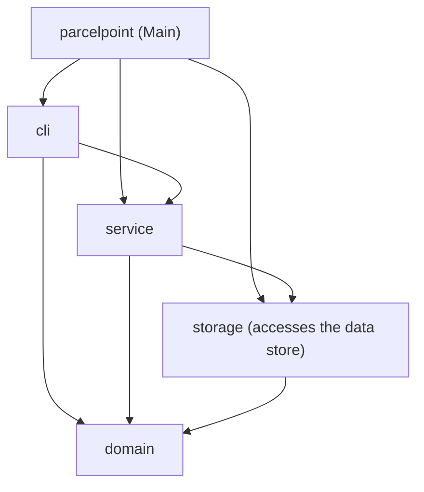
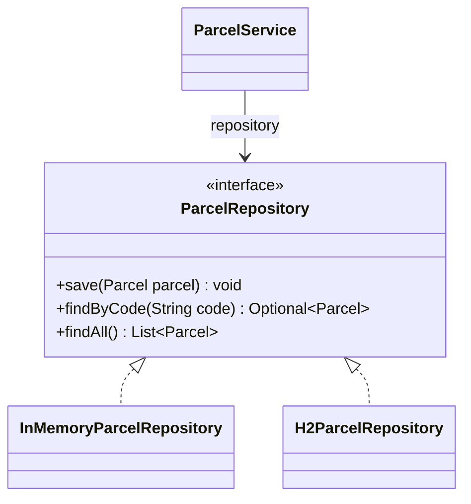
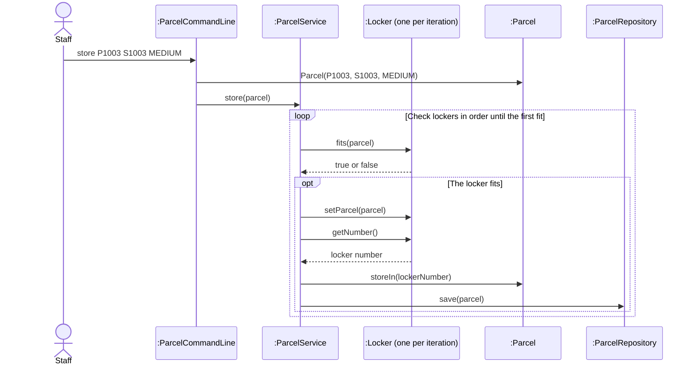

# Lab Report, Designing the Data Management Layer with H2

Repository URL: https://github.com/6788111/itcs382-h2-lab

## Tools

| Item | Version or name |
| --- | --- |
| JDK | Homebrew OpenJDK 21.0.13.0.2 |
| Maven | Apache Maven 3.10.0 |
| IDE | Visual Studio Code 1.145.2 |
| AI tool and exact model, if you used one | OpenAI Codex, GPT-6 (the session exposes no more specific model ID) |

## Part 0. From a store in memory to H2

Commit of the starter, before any change: `f2ca255`

### 0.3. Restart with the in-memory repository

Prediction: Running `staff` after a restart will show no parcels and three free lockers because the new process starts with an empty repository.

Output of the second run, for `staff` and `quit`

```text
> staff
Free lockers: 3
> quit
```

The parcels from the first run were stored in the `LinkedHashMap` inside `InMemoryParcelRepository` in the first Java process.

### 0.5. The line in Main that selects the repository

```java
ParcelRepository repository = new InMemoryParcelRepository();
```

### 0.6. Switch to H2

Commit of the switch to H2: `765ee2f`

### 0.7. Query the two stored parcels

```text
sql> SELECT * FROM PARCEL;
CODE  | STUDENT_ID | PARCEL_SIZE | STATUS | LOCKER_NUMBER
P1001 | S1001      | SMALL       | STORED | 1
P1002 | S1002      | LARGE       | STORED | 3
(2 rows, 9 ms)
```

### 0.8. Open the database from two processes

The H2 Shell held the lock on `parcelpoint.mv.db` in embedded file mode. ParcelPoint ran in a second Java process, so its attempt to connect to that file failed while the Shell was open. The constructor of `H2ParcelRepository` caught the `SQLException` and raised `IllegalStateException` with the message `Cannot create the PARCEL table`.

### 0.9. Explain why staff and find disagree

The starter implementation of `H2ParcelRepository.findAll()` returned an empty list, which is why `staff` displayed no parcels. At startup the `ParcelService` constructor also uses `findAll()` to restore waiting parcels to lockers, so the three lockers stayed empty in memory. The `find` command uses `findByCode()`, which queried H2 directly and found each saved row.

### 0.11. Implement findAll

```java
@Override
public List<Parcel> findAll() {
    String sql = "SELECT * FROM PARCEL ORDER BY CODE";
    List<Parcel> parcels = new ArrayList<>();
    try (Connection connection = connect();
         PreparedStatement statement = connection.prepareStatement(sql);
         ResultSet row = statement.executeQuery()) {
        while (row.next()) {
            parcels.add(toParcel(row));
        }
    } catch (SQLException e) {
        throw new IllegalStateException("Cannot read the parcels", e);
    }
    return parcels;
}
```

Commit that adds `findAll`: `7f5139f`

### 0.12. Query the table after pickup

```text
sql> SELECT * FROM PARCEL;
CODE  | STUDENT_ID | PARCEL_SIZE | STATUS    | LOCKER_NUMBER
P1001 | S1001      | SMALL       | PICKED_UP | null
P1002 | S1002      | LARGE       | STORED    | 3
(2 rows, 9 ms)
```

Pickup after five days gave a fee of 20.0 baht. The table still held two rows because `MERGE` matched `P1001` by its primary key and updated the existing row to `PICKED_UP` with a SQL `NULL` locker number.

### 0.13. Optional

The existing `PreparedStatement` binds the parcel code to a placeholder as a value, so JDBC keeps the lookup text separate from the SQL statement.

## Part A. Model the design

### A1. Package dependencies



The `cli` package calls `ParcelService` and works with domain objects. It has an indirect dependency on `storage` through `service`, which uses `ParcelRepository`.

### A2. Data management class diagram



### A3. Store a medium parcel



The last lifeline is `ParcelRepository` because `ParcelService` receives that interface by constructor injection and calls its `save` operation. The concrete implementation is selected in `Main`, and the sequence is the same whether it selects H2 or an in-memory repository.

## Part B. Design questions

1. The switch in Step 0.6 changed `Main.java`, which now constructs `H2ParcelRepository` and injects it into `ParcelService` as a `ParcelRepository`. This is dependency inversion because the service depends on the repository abstraction. In Step 0.11, I also completed `findAll()` in `H2ParcelRepository.java` so the H2 implementation could satisfy the existing read contract.

2. `SMALL`, `MEDIUM` and `LARGE` create connascence of name because the stored text must match `ParcelSize.name()` and `ParcelSize.valueOf()`. Storing 1, 2 and 3 based on declaration order creates connascence of position because both sides must agree on the order. If the numbers instead have a fixed meaning independent of enum order, that mapping creates connascence of convention. Name is weaker than position here because reordering the constants leaves existing rows readable.

3. Embedded H2 runs inside the Java process and writes its data to a local file, so it meets the requirement for persistent storage without a separate database server. In the embedded configuration used in this lab, the Shell held the file lock and ParcelPoint could only open the same database after the Shell closed.

4. I would choose embedded H2 for a Phase 2 app that needs to keep records across restarts and retrieve them by ID or filter by status without running a separate server. The `storage` package would own database access, with the business layer calling a repository interface. This is a proposed choice based on the lab requirements and should be confirmed against the team's requirements.

## AI usage declaration

| AI tool and exact model | Date | Purpose | Files or answers it produced or changed | How you checked its output |
| --- | --- | --- | --- | --- |
| OpenAI Codex, GPT-6 (the session exposes no more specific model ID) | 2026-11-15 | Implement the H2 repository switch and read method, run the lab and draft the report | `Main.java`, `H2ParcelRepository.java`, and `LAB_REPORT.md` | Automated checks built the project with Maven and compared CLI and H2 Shell results across restarts and pickup. The three Mermaid blocks were parsed and their relationships were checked against the Java imports and method calls. Student verification is pending. |
